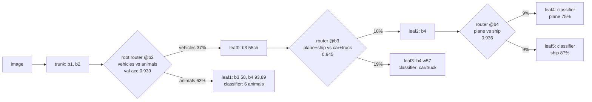
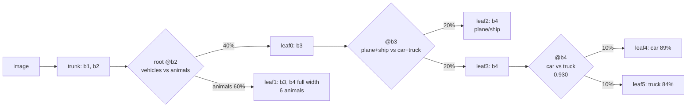
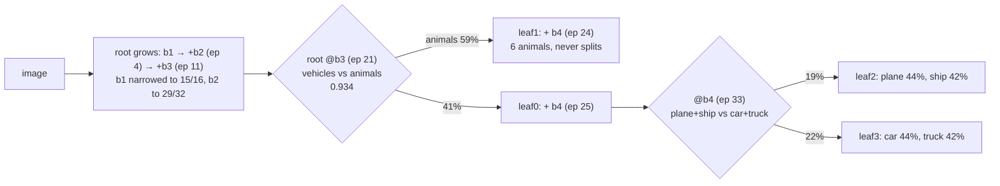
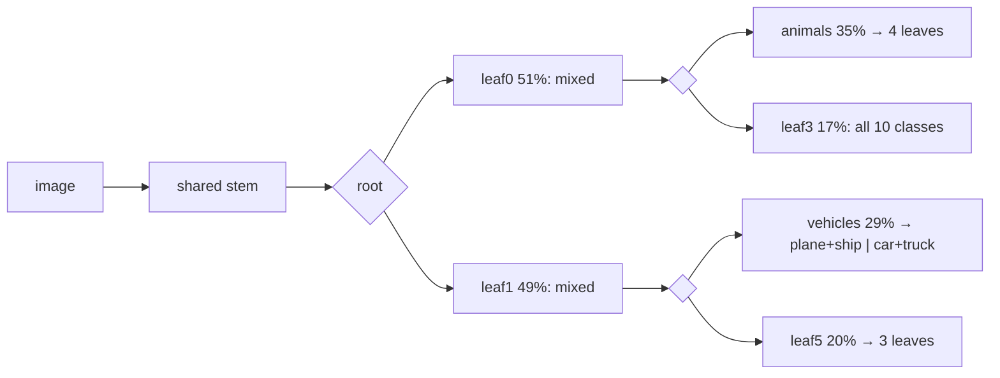

# Experiment 0008: Trunk trees on CIFAR-10

**Date:** 2026-11-03
**Status:** seed 0 done; decision pending review

## Hypothesis
Experiment [0007](0007-where-to-split.md) used off-repo probes to show that a tree inside a plain `deep4` network ties the plain network at equal MACs. The tree had a shared trunk, a supervised class-group router and per-group branches continuing from the trunk's feature maps. It also beat a no-routing network of equal reduced MACs by 2.2–2.7 points. `--model tree` ([ADR 0006](../adr/0006-tree-nodes-continue-from-parent-features.md)) builds that tree by growth: each leaf splits on groups cut from its own confusion hierarchy, at the earliest block whose probe routes them at `--route-acc-min`, and each branch keeps the channels its group activates (`--branch-keep`).

We expected the grown tree to:
- tie a plain network trained for the same number of epochs;
- use fewer beam-1 MACs;
- beat the `dag` from [0006](0006-cascade-cifar.md) on both accuracy and readability.

We also tested `--tree-growth progressive`, which starts the root at one block and grows depth as well as splits. It might find a cheaper network than one that starts from the full `deep4`.

Main criterion: beam-1 test accuracy. Cost: beam-1 MACs. Ties go to the more explainable graph.

## Variants
Grid `treecifar` in `beamroot/experiment.py`.
- **tree:** `--model tree --max-nodes 7`. Defaults: `--tree-growth settle`, `--route-acc-min 0.93`, `--branch-keep 0.95`, `--post-split-epochs 15`, plateau delta 0.03 and patience 2.
- **tree-progressive:** `--model tree --tree-growth progressive --max-nodes 7`.
- **tree-keep1:** `--model tree --branch-keep 1.0`. Branches copy the parent's remaining blocks at full width, so the run isolates routing from narrowing.
- **tree-plain:** `--model tree --max-nodes 1`, the plain `deep4` network, trained for `tree`'s `epochs_trained`.
- **tree-plain-progressive:** the same plain network, trained for `tree-progressive`'s `epochs_trained`.
- **dag:** the `cascade` grid's `dag` flags, for comparison with earlier experiments.

## Setup
- **Command:** `.venv/bin/python -m beamroot.experiment treecifar --datasets cifar10 --seeds 0 --epochs 15`, on MPS. The six runs took about 3 hours in total, from 17:55 to about 21:00 on 2026-11-02.
- **Plain reruns:** passing `--epochs 15` overrode the grid's `epochs_from`, so both plain variants trained 15 epochs, not the trees' 40 and 48. They were rerun on 2026-11-03 with `beamroot.train --model tree --max-nodes 1 --epochs 40` and with `--tree-growth progressive --max-nodes 1 --epochs 48`, each scored with `evaluate --beams 1`. They sit outside the experiment directory, so `summary.md` still shows the 15-epoch plain numbers. Launch future grids without `--epochs` so that `epochs_from` applies.
- **Training:** CIFAR-10 with crop-and-flip augmentation, batch 128, Adam at a constant 1e-3 with no schedule, seed 0. Each run's accuracy is its final epoch; no best checkpoint is kept.
- **Run length:** `--epochs 15` is a minimum. Every split or deepen moves the end to 15 epochs after that event, so the tree runs trained 38–48 epochs. `dag` does not extend its run, so it trained 15.
- **Code:** commit `8388d24`, which includes the trunk-tree progressive growth, report and grid.
- **Results:** `runs/experiments/treecifar/`.

## Results
Seed 0, one run each. Plain rows marked * come from the reruns. The `tree-keep1` baseline is the 48-epoch plain run's test accuracy at epoch 38 (a plain network's soft and beam-1 accuracy are equal).

| variant | epochs | beam-1 acc | plain at same epochs | Δ | beam-1 MACs | leaves | leaf purity | split-router entropy | beam-1 nodes |
|---|---|---|---|---|---|---|---|---|---|
| tree | 40 | 0.7900 | 0.8006* | −1.1 | **4.38M** | 4 | 0.564 | 0.222 | 2.55 |
| tree-keep1 | 38 | **0.8059** | 0.810 | −0.4 | 6.41M | 4 | **0.582** | 0.193 | 2.59 |
| tree-progressive | 48 | 0.7697 | **0.8186*** | −4.9 | 6.11M | 3 | 0.349 | 0.224 | 2.41 |
| dag | 15 | 0.7252 | 0.7599 | −3.5 | 7.00M | 10 | 0.476 | **0.049** | 4.34 |
| plain (`deep4`) | 15 / 40 / 48 | 0.760 / 0.801 / 0.819 | – | – | 6.34M | 1 | 0.100 | – | 1.00 |

Test accuracy per epoch (soft accuracy, which is within 0.6 points of beam-1 for every model here):

| epoch | 5 | 10 | 15 | 20 | 25 | 30 | 35 | 38 | 40 | 45 | 48 |
|---|---|---|---|---|---|---|---|---|---|---|---|
| plain | 0.659 | 0.730 | 0.760 | 0.779 | 0.794 | 0.798 | 0.807 | 0.810 | 0.801 | 0.808 | 0.819 |
| tree | 0.659 | 0.730 | 0.746 | 0.772 | 0.783 | 0.794 | 0.784 | **0.805** | 0.793 | – | – |
| tree-keep1 | 0.659 | 0.730 | 0.746 | 0.770 | 0.784 | 0.792 | 0.791 | 0.811 | – | – | – |
| tree-progressive | 0.318 | 0.416 | 0.522 | 0.592 | 0.650 | 0.726 | 0.736 | 0.753 | 0.754 | 0.772 | 0.773 |
| dag | 0.646 | 0.703 | 0.727 | – | – | – | – | – | – | – | – |

Up to the root split at epoch 13, `tree`, `tree-keep1` and plain are the same network on the same RNG stream, so they agree exactly. With a constant learning rate, every network's test accuracy moves by about ±1 point from epoch to epoch: plain fell from 0.810 at epoch 38 to 0.801 at epoch 40. Gaps of about a point are inside that noise.

**Headline:** at equal epochs, no tree beats the plain network on accuracy.
- **`tree`:** ties within noise (−1.1) and uses 31% fewer MACs.
- **`tree-keep1`:** ties (−0.4) at the plain network's cost, plus its routers.
- **`tree-progressive`:** clearly loses (−4.9).
- **Against `dag`:** every tree beats `dag`. At equal epochs (15), the tree was 1.9 points ahead (0.746 against 0.727), and it uses fewer MACs and fewer nodes per image.

## The models
CIFAR-10 classes: 0 airplane, 1 automobile, 2 bird, 3 cat, 4 deer, 5 dog, 6 frog, 7 horse, 8 ship, 9 truck. `deep4` widths: b1 16, b2 32, b3 64, b4 128+128 (two convs). In the diagrams, a router is a probe head that reads the feature maps after the named block. Reach is the share of test images, and leaf percentages are the class share of the images that reach the leaf.

### Plain `deep4` (`tree-plain`)

One path, every image, every channel: 6.34M MACs. It is the baseline every tree is grown from (`--max-nodes 1`). It is the most accurate model at every matched epoch count. It offers no structure to read and no saving on easy images.

### `tree` (settle growth, branch keep 0.95)

The settle tree splits vehicles from animals at b2, the depth where 0007 found the split decisive. It then splits {plane, ship} from {car, truck} at b3, and plane from ship at b4. That uses all 7 nodes. Each branch is narrowed to the channels its group activates, which is where the 31% MAC saving comes from.

- **Strengths:**
  - Every decision is a named class-group question with a measured validation accuracy.
  - It is the cheapest model here.
  - A beam-1 path visits 2.55 nodes.
  - The vehicle leaves are fairly pure.
- **Weaknesses:**
  - The animal leaf takes 63% of the images and never splits. Its best route accuracy was 0.87–0.91, under the 0.93 bar, in five tries between epochs 16 and 22.
  - The node budget went on the easy half: vehicles were already the best-classified classes. So the tree is close to a narrowed plain network with a vehicle sub-tree attached.
  - Routing is hard at beam 1. A vehicle sent down the animal branch cannot be recovered.
  - The narrowing ran without any accuracy check. Some of the −1.1 may be narrowing, not routing.

### `tree-keep1` (settle growth, no narrowing)

The tree has the same first two splits, but the third went to car against truck instead of plane against ship. Branches copy their blocks at full width, so the vehicle and animal halves each carry a full-size b3 and b4.

- **Strengths:** it is the most accurate tree and the purest (0.582), and it ties plain (−0.4).
- **Weaknesses:**
  - Per image it costs as much as plain plus the routers (6.41M).
  - The parameter count roughly doubles past b2.
  - The animal leaf has the same problem as in `tree`.
- **Reading it against `tree`:** the 1.6-point gap between `tree-keep1` and `tree` is about what narrowing at 0.95 costs. It is not significant on one seed. The pair is the clearest evidence that routing alone neither costs nor gains much accuracy here.

### `tree-progressive`

The root starts as b1 plus a classifier. When it plateaus and no block routes well, it narrows its newest block and adds the next one.

- **Strengths:** in principle it could stop at a shallow, cheap network if the data allowed.
- **Weaknesses:**
  - CIFAR-10 does not allow it. The root deepened twice, and every leaf ended at b4, so the final network costs about the same as plain (6.11M).
  - It spent its first 24 epochs as a shallower network: 0.52 test accuracy at epoch 15, against 0.76 for plain.
  - Each deepen replaces the classifier and resets the plateau history. The full-depth network got far fewer effective epochs than its 48 suggest.
  - It stopped at 5 nodes. The animal leaf failed the bar 11 times, and the vehicle leaves end at b4 with two classes each, unsplit (purity 0.35).
- **Verdict:** it reaches the same tree as settle, later and worse.

### `dag` (for reference)

`dag` grows by clustering hidden activations, so its root split is not a class split: each child sees all 10 classes. It has the most decisive routers (entropy 0.049) and the most leaves (10), and it is the only model that splits the animals. It also has the least accuracy, the highest MACs and the longest paths (4.34 nodes). One leaf (`leaf3`, 17% of images) holds all ten classes and explains nothing.

## Could more training or adjustment close the gap?
- **Learning-rate schedule (likely the biggest lever, for every model):**
  - The plain network was still climbing at epoch 48 (0.819), and every run bounced about ±1 point per epoch.
  - Adam at a constant 1e-3, scored on the final epoch, both understates accuracy and adds noise. `tree` peaked at 0.805 at epoch 38 and ended at 0.790.
  - Two changes should help: a cosine or step decay over the last 10–15 epochs (at the start of each post-split window for trees), and scoring the best-validation checkpoint as 0007 did. Both would likely add a few points and make one-seed comparisons readable.
- **More epochs:** they help everyone. The useful question is whether the tree-to-plain gap closes, and that needs the schedule fix first.
- **More seeds:** the `tree` gap (−1.1) and the `tree-keep1` gap (−0.4) are inside epoch-to-epoch noise. Seeds 1–2 for `tree`, `tree-keep1` and their plain baselines would settle them, ideally after the schedule fix.
- **Splitting the animals:**
  - The animal branch carries 60% of the images and most of the errors. The 0.93 bar is too high for animal groups at any block (best 0.91, for {bird, cat, dog, frog} against {deer, horse}).
  - The options:
    - a per-split bar, or a bar relative to the parent's accuracy on those groups;
    - k-way splits;
    - beam-2 routing on low-confidence animal images, so a wrong route can be recovered.
  - Accuracy would gain most here if routing gains anywhere.
- **Narrowing:** `--branch-keep 0.95` costs about 1.6 points, against keep 1.0, for a 31% MAC saving. A 0.97–0.99 sweep, or the planned accuracy-checked narrowing, may keep most of the saving.
- **`tree-progressive`:** not worth tuning on CIFAR-10. The data needs the full depth, and progressive growth arrives there late. Starting the root at b2, or waiving patience for deepening, might recover a few points. Even then it would at best match settle.

## Ideas to try next
1. **Pruned plain control (most important):** narrow the plain network by activation share at 0.95 with no routing, and train it for 40 epochs. If it matches `tree`'s 0.79 at about 4.4M MACs, the tree's MAC saving is pruning, not routing.
2. **Schedule fix and best-checkpoint scoring**, then rerun `tree`, `tree-keep1` and plain over seeds 0–2.
3. **Route-error audit:** count the beam-1 errors caused by a wrong route, against those made by the correct leaf. If wrong routes are rare, routing is free and the gap is leaf capacity. If they are common, try beam-2 or a lower bar.
4. **Animal splits:** a lower or per-group bar, k-way animal splits, or splitting the animal leaf first by giving priority to the leaf with the most reach-weighted loss.
5. **Early exit on vehicles:** 0007 found 19–32% savings for 0–0.25 points. The vehicle half is decided early and confidently, so it is the natural place to stop early.
6. **Smaller budgets:** 0007's tree beat a no-routing network of equal reduced MACs by 2.2–2.7 points. A `--width 8` or 12 grid would test whether trees win where capacity is tight, which may be routing's real niche.
7. **Fix the grid's epoch matching:** make `--epochs` not override `epochs_from`, or warn when it does, so the plain baselines match without a rerun.

## Explainability
- **The tree is the most readable model built so far.** Every router answers a question a person can state:
  - vehicles or animals;
  - plane or ship against car or truck;
  - plane or ship.

  Each answer has a measured validation accuracy logged at split time (`growth.jsonl`). An image's beam-1 path reads as a short chain of such decisions, 2.4–2.6 nodes long, against 4.3 for `dag`.
- **The split points mean something.** The router sits at the earliest block that separates its groups, so the tree shows where in the network a distinction becomes available: vehicles against animals by b2, plane against ship only by b4.
- **Failures are readable too.**
  - In `tree`, 6% of the airplane leaf's images are birds. The router sent "sky-like" animals down the vehicle path, a mistake a person can recognise and check.
  - `dag`'s mixed leaves give no such story.
- **The weak spot is the animal branch.** For 60% of images, the explanation stops at "it is an animal", and a 6-class black box decides the rest. Readable trees need the animal split as much as accurate ones do.
- **Routers are confident but not certain.** Split-router entropy is 0.19–0.22, against 0.05 for `dag`, and soft accuracy is only 0.3–0.6 points above beam-1. Routes are rarely ambiguous enough for a second beam to help, but each routing error is final.
- **The trade-off for explainability-first:** `tree` ties plain within noise. It is cheaper, and much easier to read than `dag` or a plain network. If the route-error audit and more seeds confirm the tie, it is the strongest candidate so far for the project's default CIFAR-10 model.

## Not tried
- Seeds 1–2, deferred until the schedule fix, since one-epoch noise matches the gaps being measured.
- Accuracy-driven narrowing, early exit, soft or path-loss tree routers, and merges or links in trees: all out of scope for the trunk-tree feature.
- MNIST: the question was CIFAR-10, where 0006 had found routing lost.

## Decision
Pending review. Suggested: keep `--model tree` with `settle` growth. Shelve `--tree-growth progressive` for CIFAR-10. Run ideas 1–3 before claiming a MAC win from routing.
